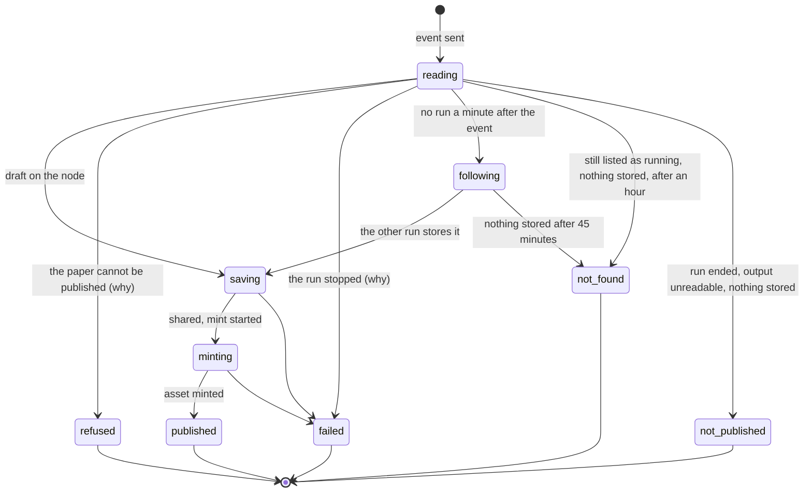
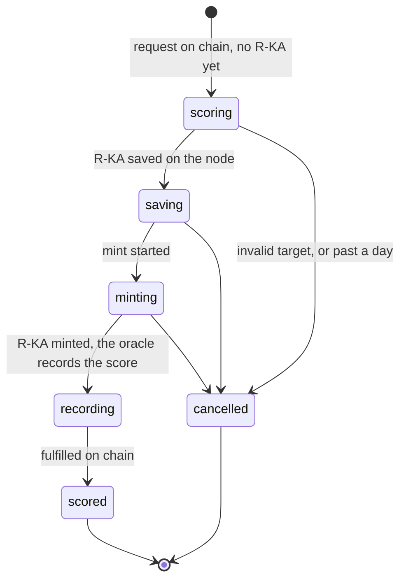

# @verisci/web

The Next.js 16 app (App Router).

Status: the home page; the upload pages, where a visitor connects a wallet, publishes a PDF,
follows it until its Target KA is minted and verifies its record; the list of published
papers, with each paper's score; ratings, where a published paper's page lists its ratings
and requests one from the wallet, and each rating's page follows it to its score and shows
every check behind it; `/api/inngest`, which serves the workflows' Inngest functions
([ADR 0003](../../docs/adr/0003-inngest-functions-live-in-workflows.md)); and
`/api/webhooks/alchemy`, which takes the Alchemy Notify webhook's rating requests
([ADR 0017](../../docs/adr/0017-chain-events-are-ingested-at-least-once.md)).

Architecture views: [`.omm/overall-architecture/web-app/`](../../.omm/overall-architecture/web-app/), [`.omm/route-page-map/`](../../.omm/route-page-map/), [`.omm/state-transitions/paper-page/`](../../.omm/state-transitions/paper-page/), [`.omm/state-transitions/rating-page/`](../../.omm/state-transitions/rating-page/) (`pnpm exec omm view --port 4000` shows them; root README → Architecture).

## Depends on

All five packages: `@verisci/env`, `@verisci/core`, `@verisci/dkg`,
`@verisci/contracts`, `@verisci/workflows`. Each one must be listed in
`transpilePackages` in `next.config.ts`. Also `inngest` (the `/api/inngest` route's `serve`
handler); Reown AppKit, wagmi, viem and TanStack Query (the wallet); `@upstash/ratelimit`
and `@upstash/redis` (the limits); Zod (settings and run outputs); `@next/env` (loads the
root env files in `next.config.ts`); TanStack Table (the papers table); Tailwind CSS, with
`clsx` and `tailwind-merge` for shadcn's `cn` (`lib/utils.ts`); and Phosphor icons. `next.config.ts`
points the optional `@x402/*` packages, reached through wagmi's connectors, at
`lib/empty-module.ts` (`docs/domain.md` → Next.js).

## Pages and routes

| Path | What it is |
| --- | --- |
| `/` | Home: what VeriSci does, with a demo that publishes a paper and then rates it, the latest papers (the five newest, streamed in with a skeleton, linking to `/papers`), the DKG's two layers (the record off-chain, its ERC-721 token and merkle root on-chain, the UAL linking them), how publishing and rating work (phase 1 live, human review and replication to come), and an example paper asset |
| `/publish` | Connect a wallet, drop a PDF, sign once; what publishing means and the limits ([ADR 0010](../../docs/adr/0010-pdf-to-target-ka-pipeline.md), [ADR 0034](../../docs/adr/0034-users-connect-a-wallet-anyone-may-publish.md)) |
| `/papers?page=<n>` | Every paper this environment published, newest mint first, 20 to a page, each with its score (below) |
| `/papers/<cid>?event=<id>` | Where a paper stands, then its record, abstract and how to verify it, and its Ratings section (`#rating`) once published (below), under "Papers / <title>" breadcrumbs. `?already=1` says a re-submitted PDF was already published |
| `/api/papers/<cid>?event=<id>` | The same as JSON (`PaperView`: the stage, and the record once published), never cached: a read, so a route rather than a server action |
| `/papers/<cid>/ratings/<requestId>` | One rating: where it stands until it is scored, then its score and every check behind it, or why it was cancelled (below), under "Papers / <title> / Rating" breadcrumbs |
| `/api/ratings/<requestId>` | The same as JSON (`RatingView`), never cached, for the rating page to poll; not-found for an id that is not `0x` + 64 hex digits, or where no contract takes ratings |
| `/api/inngest` | Serves the Inngest functions: the publish function and the failure alerts, plus the rating, oracle, reconciler and health functions where the oracle key is set |
| `POST /api/webhooks/alchemy` | The Alchemy Notify webhook's deliveries: hands the raw body and `X-Alchemy-Signature` to the workflows' intake (`getWebhookIntake`) and answers its status, with an empty body: 200, 401 (bad signature), 400 (not a delivery), 503 (Inngest refused, so Alchemy Notify delivers again), or 404 where `ALCHEMY_WEBHOOK_SIGNING_KEY` is unset (`packages/workflows` README → The Alchemy Notify webhook) |
| any other path | `app/not-found.tsx`; a page that fails to render shows `app/error.tsx` with a retry |

`app/actions.ts` holds three server actions. Locally, `announceLocalRating(txHash)` has the
server announce a rating request (The Ratings section, below). The publish form calls the
other two: `requestUpload()` signs a
Pinata upload URL within the connection's daily limit, and `submitPaper(input)` checks the
signed submission and starts its publish run within the address's daily limit
([ADR 0035](../../docs/adr/0035-limits-are-the-apps-only-state.md)). The browser
(`lib/publish/publish-flow.ts`) first refuses a file that is not a PDF (by its type, or, when the
picker gives none, by the `%PDF-` it must start with) or is over 15 MB, before spending an
upload URL. It then uploads the PDF straight to Pinata, canonicalizes the CID it answers,
and has the wallet sign `{ cid, contextGraph, deadline }` with a deadline 10 minutes ahead.
The work itself is `@verisci/workflows`' `getUploadService()`
([`packages/workflows`](../../packages/workflows/README.md#the-pages-calls)).

Limits (`lib/publish/limits.ts`): 10 upload URLs per connection (IP) and 5 submissions per signing
address, each per rolling day, in Upstash; in memory with `APP_ENV=local` and no Upstash
settings, reset when the server restarts. A limit store that does not answer refuses
rather than letting requests through.

A service that does not answer gives the visitor "A service we rely on didn't answer", and
the server logs one warning naming it: `upload-url-unavailable: <service>: <what came back>`
(`upstash`, `pinata`) for an upload URL, `submit-unavailable: …` for a submission
([`packages/workflows`](../../packages/workflows/README.md#the-pages-calls)). The line never
carries a key, a URL or the visitor's IP: the limits drop the command Upstash echoes in its
errors, whose key holds the IP.

### The papers list

`/papers` reads one page from the DKG node per request (`listPapers`,
[`packages/workflows`](../../packages/workflows/README.md#the-pages-calls)), with no database
([ADR 0035](../../docs/adr/0035-limits-are-the-apps-only-state.md)): the papers newest mint
first, the total, each paper's first three authors (or how many it has, when none could be
named) and its signature check. The heading
shows at once and the rows stream into a `Suspense` boundary keyed by page, with a skeleton
shaped like the table (`components/papers/papers-table-skeleton.tsx`).

- The table (`components/papers/papers-table.tsx`) is TanStack Table v9 with core features
  only, since the server sorts and pages; its columns are module constants
  (`papers-columns.tsx`), drawn with shadcn's table restyled with the app's tokens
  (`components/ui/table.tsx`). Below `md`, each row is one stacked cell.
- Page links (`components/papers/pager.tsx`) are plain links to `/papers?page=N`, so each page
  is a URL the server renders: the first, the last and the current page's neighbours past
  seven pages.
- A `?page=` that is not a positive whole number, or one so far out that page × 20 passes
  `Number.MAX_SAFE_INTEGER`, answers 404 before anything streams. A page past the last shows
  the not-found page, as a 200 with `noindex`, since the response is already streaming when
  the node answers (`docs/domain.md` → Next.js).
- The Score column shows each paper's latest phase-1 score, the contract's
  ([ADR 0014](../../docs/adr/0014-contract-owns-scores-dkg-owns-content.md)), in the on-chain
  teal, followed by the phase it reached, "phase 1"
  ([ADR 0012](../../docs/adr/0012-three-phases-settled-by-the-oracle.md)); otherwise its state
  in words, summed by `summariseRatings`, the rule the paper page
  shares: "Pending", "Can't be rated" (a request was cancelled as invalid), "Not rated" with a
  Rate link to the paper's Ratings section where a contract takes ratings, or "Not checked"
  when the chain did not answer within 6 s, so a slow chain never holds the list
  (`lib/papers/ratings.ts` → `withRatings`).
- A node that does not answer says the list can't be loaded, with a link to try again; an
  answer that can't be read (a refused query, or a page the total covers with no readable
  row) says so, without the link. On the home page, the latest papers block says it can't
  load them in either case, and only that block
  ([ADR 0021](../../docs/adr/0021-server-reads-return-typed-results.md)).

### The paper page

The server reads where the paper stands (`components/paper/paper-loader.tsx`, the same
`readProgress` as `/api/papers/<cid>`) inside a `Suspense` boundary. Until the node answers,
a skeleton shows the breadcrumbs, the side panel's real heading, groups and labels, and the
PDF's CID, with only the values pulsing: the chain of steps and the publish panel's labels
when the address has `?event=`, a published paper's shape (abstract, one row of steps) and
the verify panel's otherwise (`components/paper/labels.ts` holds the labels both use).
`components/paper/paper-progress.tsx` then follows the paper from that first view: unless it
is final, it asks `/api/papers/<cid>` every 5 s and stops on a final stage. It shows and asks
by the CID's canonical spelling, the one the signature covers, whatever spelling the address
has. `lib/publish/progress.ts` (`paperProgress`, pure) maps the
asset's state on the node, the run Inngest started for the event, and why that run stopped
to one stage:

- A minted asset is `published` whatever the run says, so a second submitter of the same
  PDF sees it at once.
- `refused` shows why (`lib/publish/messages.ts` → `refusalMessage`): not a PDF, too large,
  unreadable, no title or no text (with a hint for PDFs whose pages are pictures), a paper
  outside the field (VeriSci publishes life-science and health papers only, the field named
  as [ADR 0037](../../docs/adr/0037-verisci-rates-life-science-and-health-papers.md) names
  it), or a submission that failed its checks.
- `failed` shows why the run stopped (`failureMessage`): Base, the PDF, the DKG node or
  the mint not answering after every retry, or a problem on our side.
- `following`: the event started no run a minute after it was sent (its time is read from
  its ULID, `eventTime`). The publish function is a singleton per CID, so another run holds
  this PDF; the page follows the paper on the node and gives up (`not-found`) after
  `FOLLOW_MS`, a run's whole 45-minute budget.
- `not-found` also covers a page with no event to ask about and nothing on the node, and a
  run still listed as running an hour after its event with nothing on the node
  (`STALE_RUN_MS`: the run's budget, which counts from its start, plus a margin for a late
  start); Inngest has cancelled it by then.
- `unavailable` (the node or Inngest not answering) is shown and asked again.
- A published paper whose record the node did not answer for, or does not show yet after
  its run minted it (`recordProblem: "unavailable"`), is asked about again until the record
  loads; one whose record cannot be read says so
  ([ADR 0021](../../docs/adr/0021-server-reads-return-typed-results.md)).

Once published, the page leads with the paper: the record (title, sized by its length,
authors, DOI), then its abstract (`components/paper/abstract.tsx`: past 420 characters, cut
to five lines with a "Read more" toggle), then the publish steps as one row of done steps.
Beside it, a "Verify it yourself" panel (`components/paper/verify-panel.tsx`) shows the
signature checked when read, then two groups: "The submission" (the submitter, the
signature, its deadline and the context graph) and "The asset" (the agent address the asset
is minted to, which is our node and the UAL's author; the asset's ERC-721 token in
OriginTrail's `DKGKnowledgeAssets`, `lib/papers/explorer.ts` → `assetTokenUrl`; the UAL; and the
PDF's CID, linked through Pinata's public gateway, `ipfsUrl`, since ipfs.io no longer
serves files). Addresses and the token link to Basescan. "How to check this record" gives
the EIP-712 domain and type to check the signature with. A page that follows a paper to
Published asks the server to render it again (`router.refresh`), so the Ratings section
appears without a reload.

### The Ratings section

Under a published paper, the server reads its ratings inside their own `Suspense` boundary,
behind a skeleton with the real headings (`components/rating/ratings-section.tsx`, through
`getRatingService().listRatings`,
[`packages/workflows`](../../packages/workflows/README.md#the-pages-calls)):

- Phase 1, reproducibility readiness, leads: the latest score recorded on chain with a link
  to its checks; "Rating in progress" with a link to follow it; "Can't be rated" when a request
  was cancelled as invalid; or "Not rated yet" with what a rating does. The words are the
  papers list's (`summariseRatings`).
- **Rate this paper** (`components/rating/rate-button.tsx`, the flow in
  `lib/rating/request-flow.ts`): connects the wallet or switches it to the rating chain, sends
  `requestPhase1(ual)` to the environment's current contract
  ([ADR 0023](../../docs/adr/0023-a-fix-is-a-redeploy-owner-powers-fixed.md)), waits up to 90 s
  for the receipt, reads the request id from its `Phase1Requested` log and opens the rating's
  page. Locally, it first has the server announce the request (`announceLocalRating`), since no
  Alchemy Notify webhook watches Anvil
  ([ADR 0036](../../docs/adr/0036-local-rating-runs-use-anvil.md)); when that fails, it says the
  request is on chain but its rating didn't start, and that the `pnpm dev` terminal says why
  (`rating-announce-unavailable`), with a link to the request's page. It says when the wallet
  already has 3 ratings waiting
  ([ADR 0015](../../docs/adr/0015-rating-requests-are-free-on-testnet.md)), when ratings are
  paused, when the contract refused a mined request, and when no receipt came in time. A paper
  that can't be rated has no button.
- The history lists every rating, newest first, each with its day, its outcome and a link to
  its page; then the three phases: reproducibility readiness (live), human review (next) and
  wet-lab replication (later)
  ([ADR 0012](../../docs/adr/0012-three-phases-settled-by-the-oracle.md)).
- A chain that does not answer says the ratings can't be loaded, with a link to try again;
  where no contract takes ratings, the section says so and reads nothing.

### The rating page

`components/rating/rating-loader.tsx` reads the rating (`readRating`) and the paper's title on
the server; `components/rating/rating-progress.tsx` then asks `/api/ratings/<id>` every 5 s
until the rating is scored or cancelled (`lib/rating/stage.ts`):

- While pending, the page shows the steps as the publish page's chain (Scored, Saved
  off-chain, Minted on-chain, Recorded on-chain; `components/rating/rating-steps.ts`), what
  happens during the current one, and when the rating was requested; past 15 minutes
  (`lib/rating/elapsed.ts`), a note that it is taking longer than usual, most often because
  the scoring model is busy.
- Scored (`components/rating/rating-detail.tsx`): the contract's score, flagged when the R-KA
  records another ([ADR 0014](../../docs/adr/0014-contract-owns-scores-dkg-owns-content.md));
  the study type and the rationale; each check with its answer and quote, and for a check
  that lost its point what the scorer claimed and why it didn't count (`lib/rating/checks.ts`);
  whether the paper's text was shortened; the model and prompt version; and links to the R-KA
  and the contract (unlinked on Anvil).
- Cancelled: why, in plain words (`lib/rating/messages.ts` → `cancelMessage`): the paper can't
  be rated (outside the field, a PDF whose text can't be read, not one of VeriSci's papers,
  or no usable answer from the scoring model), or the rating couldn't finish within a day.
- A rating no contract holds, one of another paper, or any under a paper that isn't
  published, is the not-found page. A chain that does not answer is asked again, and a rating
  it then shows of another paper reads "No rating here". A DKG node that does not answer leaves the rating showing,
  from the chain, under the paper's short address, with a note that the title and checks
  can't be shown ([ADR 0021](../../docs/adr/0021-server-reads-return-typed-results.md)).
  Where no contract takes ratings, the page says so.

To rate a paper locally through these pages, against a contract on Anvil, see
[`packages/workflows` → Running a rating locally](../../packages/workflows/README.md#running-a-rating-locally).

## Code layout

- `app/`: the pages, the route handlers and the server actions.
- `lib/`: each flow's logic, pure or with its IO passed in, tested in unit tests, in the
  flow's folder: `publish` (the upload, the publish form's steps, a paper's progress, the
  messages and the limits), `papers` (the list, its rating summaries and explorer links) and
  `rating` (the request flow, the rating chain, a rating's stage, its checks, the time since
  the request and the messages). Only helpers several
  areas share sit at its root: `web-env`, `server`, `site` (the name and description the
  metadata, the footer and the wallet window read), `theme`, `shorten`, `utils` and
  `empty-module`.
- `components/`, grouped by area: `site` (the shell every page shares: logo, header links,
  theme button, footer, breadcrumbs), `wallet` (the wallet providers and button),
  `home` (the hero's demo and the latest papers), `papers` (the papers list), `paper` (one
  paper's page and its step chain, which the rating page and the demo reuse), `rating` (the
  Ratings section, the Rate button and the rating page), `publish`, and `ui`
  (shadcn primitives, restyled with the app's tokens). Tests sit next to their component.

## Design

The "Clinical" look: a clinical record with an on-chain proof, in Tailwind CSS v4 (`app/globals.css`):

- Two themes: light by default, dark once the visitor picks it with the sun and moon button
  in the header; the choice is kept in this browser (`localStorage`). `THEME_SCRIPT`
  (`lib/theme.ts`) sets `<html data-theme>` in `<head>` before the first paint, so no page
  flashes the other theme, and Tailwind's `dark:` variant follows that attribute. The
  button's name is the same in both themes and CSS picks its icon, so it is right before
  JavaScript runs. AppKit's wallet window follows the same theme. Every colour is a token
  defined for both themes: light accents are dark enough for AA text contrast, and dark is
  a deep blue-grey with solid panels one step lighter than the page. `app/globals.test.ts`
  reads both themes' tokens and holds text to WCAG AA (4.5:1 on the page for ink, muted,
  both accents and danger, accent text on its fill, white on `accent-deep`).
- The "Clinical" look: a cool off-white page (deep blue-grey in dark), a soft wash across
  the top of each page (blue from the top left, teal from the top right), one soft glow
  behind the hero. Raised panels
  with hairline borders hold figures, tools, tables and lists: the hero's demo, the
  UAL figure, the example asset, the papers table and its messages, the paper page's verify,
  publish and Ratings panels, the rating page's panel, the publish form and the footer's
  contracts. Elsewhere, coloured
  edges, timelines and hairline rules group the content, with one call to action per page.
- Two signal colours with one meaning each: blue for the off-chain record, teal for the
  on-chain asset. They blend only on the logo, the main action, live lines, and the line
  linking a save to its mint in the step chains (`StepChain`, which draws the line between
  two on-chain steps teal). Text links are ink with a blue underline
  (`link`); addresses in the papers list and the footer's contract links are muted and
  turn teal on hover. The header's wallet button is neutral, so each page's own call to
  action leads.
- Sora for text, Martian Mono for on-chain values (`next/font`), Phosphor icons. One radius
  scale: `rounded-2xl` panels, `rounded-xl` buttons and inputs, `rounded-lg` small
  controls, `rounded-md` flags.
- The hero's panel plays the example paper being published, its UAL coming out once minted,
  then the same paper being rated, its score (67, its real staging rating) coming out once
  recorded (`components/home/chain-demo.tsx`). Publish and Rate tabs pick one flow, which then
  loops on its own; both flows share one grid cell, so the panel keeps one height and the
  hero beside it never moves. The example is a real staging record whose signature checks
  out, the same as the example asset lower on the page. Beside "Publish a paper", a "Browse
  papers" link.
- Motion: the hero's flows loop and the step being worked on breathes; the home
  sections after the hero rise in as they enter the screen (`reveal`, a CSS scroll-driven
  animation, where the browser supports one). All of it stops for visitors who ask for
  reduced motion.
- Every page works from 360 px wide, one column on phones, and the page clips any overflow
  (`overflow-x: clip`, which keeps the sticky header working). The home hero fills the
  first screen, so the next section starts below the fold; below `md`, the hero's text
  fills the first screen and its panel starts just under the fold. On-chain values show in
  short form with a copy button.
- The product name is VeriSci, for life-science and health papers; its name and description
  come from `lib/site.ts` (`SITE`). Its mark (`components/site/logo.tsx`, and `app/icon.svg`
  for the tab, in fixed colours that read on light and dark tabs) is a heartbeat whose last
  beat is a check, drawn from the record's blue into the proof's teal.
- Keyboard users get a skip link and one accent focus ring; the header underlines the
  current page's link in blue. On phones the wallet button is a wallet icon (with a dot
  once connected) beside the theme button, so the header keeps one line; once connected it
  is named by the short address it shows, and AppKit's own window opens from it.
- What the DKG node answers loads behind a skeleton shaped like what replaces it, streamed
  in a `Suspense` boundary; what is known already (labels, the CID) shows at once.
- The footer (`components/site/site-footer.tsx`) lists the contracts on Base Sepolia, linked on
  Basescan: OriginTrail's `DKGKnowledgeAssets` and `KnowledgeAssetsLifecycle`
  (`ORIGINTRAIL_CONTRACTS` from `@verisci/core`), and the RatingController this
  environment's pages use (`lib/rating/chain.ts`): locally the Anvil one, unlinked.

## Environment

`next.config.ts` loads env files from the repo root (`.env.local` and friends; see
[`.env.example`](../../.env.example)). Keep them there, not in `apps/web`: Next.js
would mix the two unpredictably when it reloads. Next.js only watches `apps/web`,
so restart `pnpm dev` after editing a root env file. Variables already set in the
environment (CI, the host) take precedence.

Its own settings are declared in `lib/web-env.ts` (`createWebEnv`), the first three required
unless `APP_ENV` is `local`:

| Variable | Value |
| --- | --- |
| `UPSTASH_REDIS_REST_URL`, `UPSTASH_REDIS_REST_TOKEN` | Upstash Redis's REST address and token, for the limits: one database shared by every environment, each counter named after its `APP_ENV` (`verisci:staging:upload-url`), since Upstash's free plan allows one ([ADR 0005](../../docs/adr/0005-staging-and-production-are-isolated.md)). The token is secret |
| `REOWN_PROJECT_ID` | The Reown project id for the wallet window, from one project shared by every environment, read on the server and handed to the page, so nothing is inlined at build time. Without it the pages say the wallet is not set up |
| `LOCAL_CHAIN_RPC_URL`, `LOCAL_RATING_CONTRACT` | Optional, read only when `APP_ENV=local`: Anvil's URL and the RatingController deployed there. With both, the pages read and request ratings on that contract and the wallet window offers Anvil; without either, the paper and rating pages say ratings aren't set up, the papers list shows no Rate link, and the wallet window offers only Base Sepolia ([ADR 0036](../../docs/adr/0036-local-rating-runs-use-anvil.md)) |

The pages also need the workflows' settings (DKG, Pinata, chain, Gemini, Inngest;
[`packages/workflows`](../../packages/workflows/README.md#environment)). With
`APP_ENV=local`, `/api/inngest` and the upload page talk to the Inngest dev server.
`instrumentation.ts` checks the workflows' and the web app's settings when a deployed server
starts, so a bad one stops it there; it checks the rating settings too in production, which
refuses to start without its oracle key, and on staging when the key is set
([`packages/workflows`](../../packages/workflows/README.md#environment),
[ADR 0019](../../docs/adr/0019-oracle-transactions-are-serialized.md)). It checks nothing when `APP_ENV` is `local`, and does
not run during `next build`. On Vercel, a server starts on a request after the deploy is
live, so a missing setting makes every route fail: set them in each Vercel environment
before its first deploy, and allow each deployed domain in the Reown project.

## Deploying

Vercel builds the site from one project (`verisci`, Hobby): Root Directory `apps/web`, the
Next.js preset, the install and build commands it detects (pnpm from `packageManager`, Node
24.x from `engines`), and no `vercel.json`. Production tracks `main`; every other branch is a
preview, and `develop`'s, at its stable branch URL, is staging.

- **Deployment Protection** keeps previews private. Its Protection Bypass for Automation
  secret goes into Inngest's Vercel integration, which also sets `INNGEST_EVENT_KEY` and
  `INNGEST_SIGNING_KEY` and syncs the app on each deploy, and at the end of the staging
  webhook's URL ([`packages/workflows`](../../packages/workflows/README.md#the-alchemy-notify-webhook)).
- **Variables** (Settings → Environment Variables): `APP_ENV` (`production`, or `staging` for
  Preview), `DKG_CONTEXT_GRAPH` and `DKG_TOKEN` take one value per environment;
  `ORACLE_PRIVATE_KEY`, `TELEGRAM_BOT_TOKEN`, `TELEGRAM_CHAT_ID` and
  `ALCHEMY_WEBHOOK_SIGNING_KEY` go on Production and on Preview limited to the branch
  `develop`, so feature previews never rate or post; every other variable takes one value
  for both. System Environment Variables stay exposed: Inngest reads `VERCEL_GIT_COMMIT_REF`,
  and the notifications' links `VERCEL_BRANCH_URL` and `VERCEL_PROJECT_PRODUCTION_URL`.
- **Inngest's `develop` branch environment** has auto-archive off
  ([ADR 0005](../../docs/adr/0005-staging-and-production-are-isolated.md)).
- A deployed server checks its settings when it starts (above), so each variable is set
  before the environment's first deploy.

## Scripts

| Command | What it does |
| --- | --- |
| `pnpm --filter @verisci/web dev` | Starts the dev server on http://localhost:3000 |
| `pnpm --filter @verisci/web build` | Production build; needs `APP_ENV` (from the root `.env.local` locally) |
| `pnpm --filter @verisci/web start` | Serves the production build |
| `pnpm --filter @verisci/web inngest` | Starts the Inngest dev server (http://localhost:8288), pointed at `/api/inngest`; run it next to `dev` |
| `pnpm --filter @verisci/web typecheck` | Generates Next's types (`next typegen`), then runs `tsc` |
| `pnpm --filter @verisci/web test` | Runs its Vitest project (`vitest run`) |
